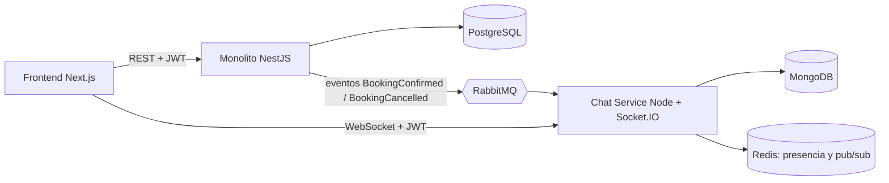
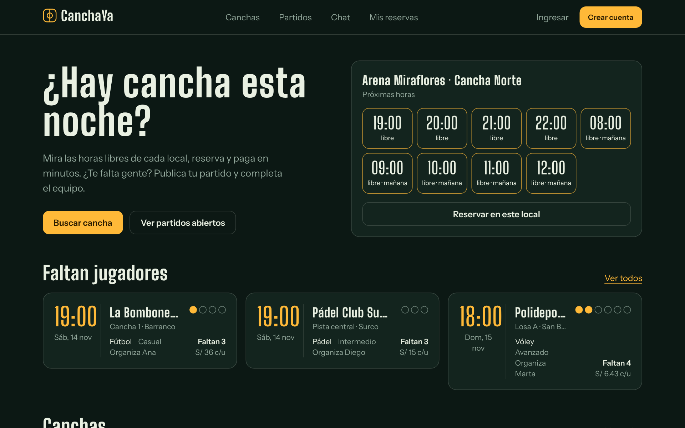
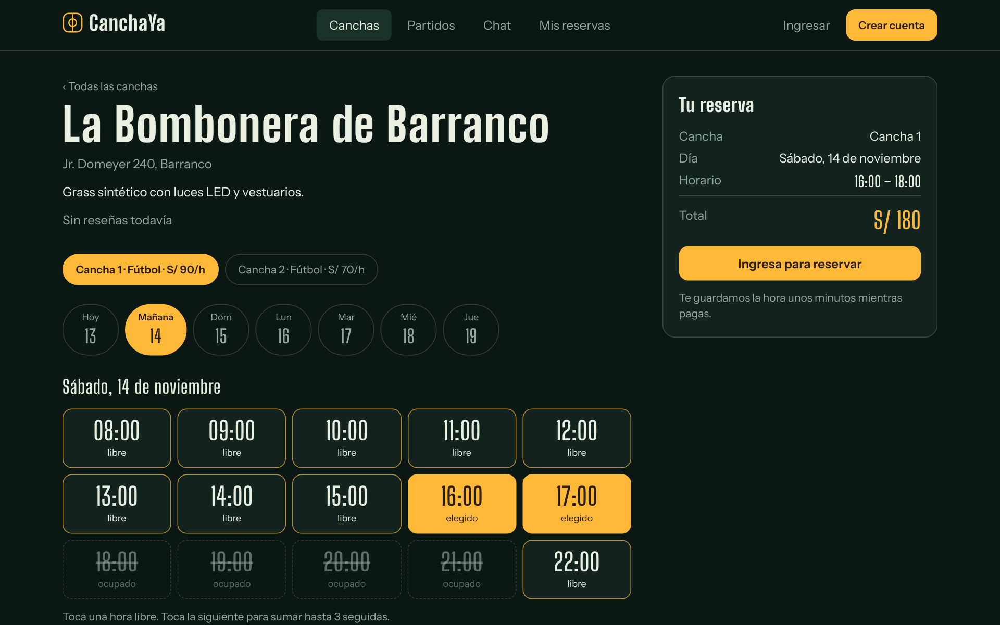
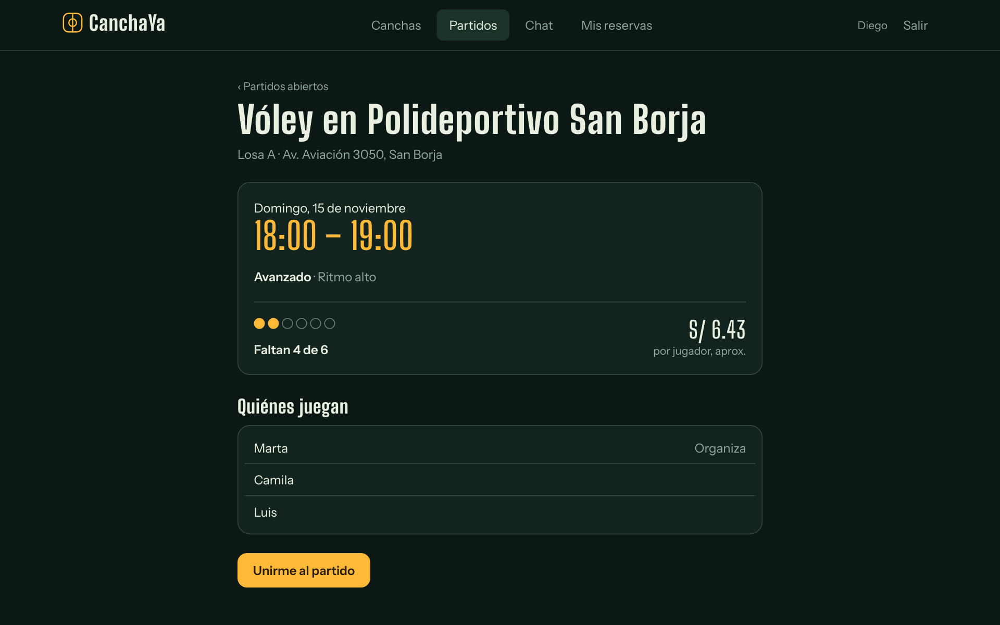
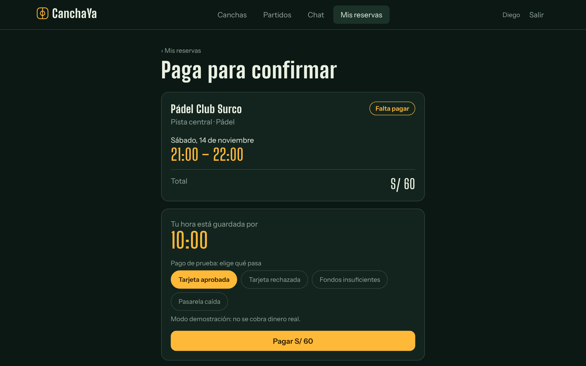
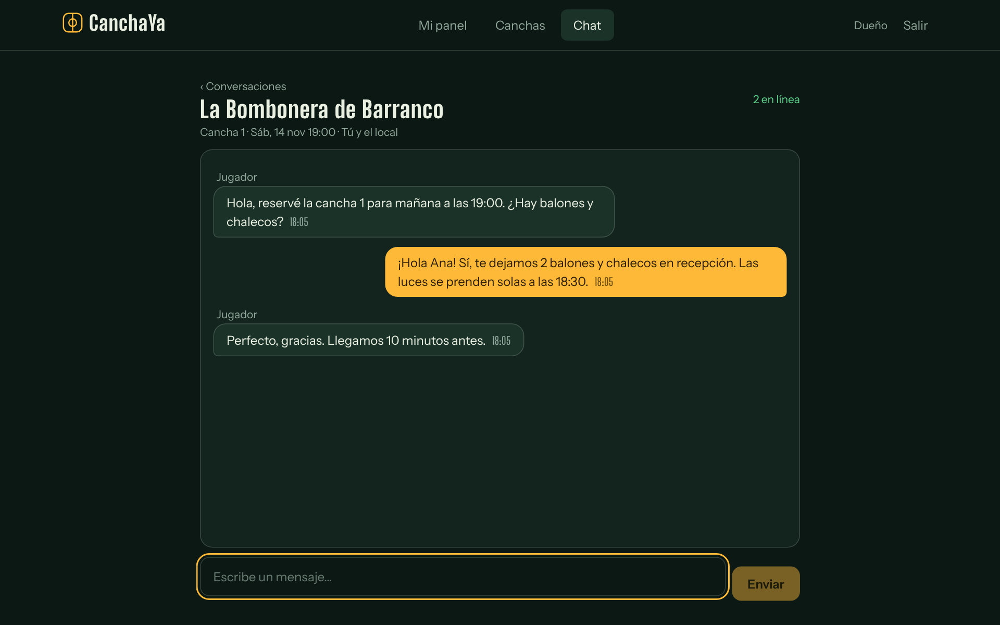
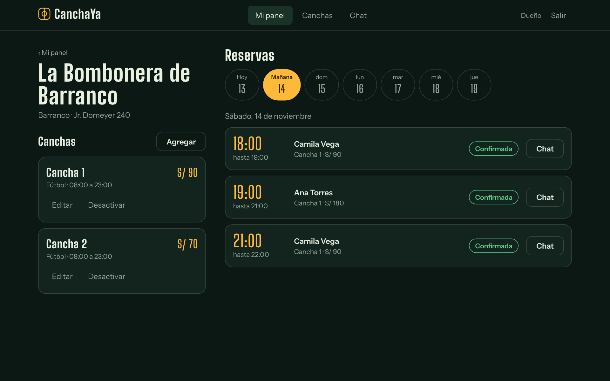
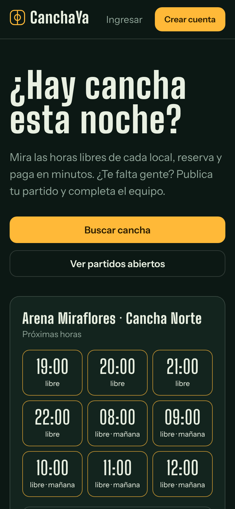
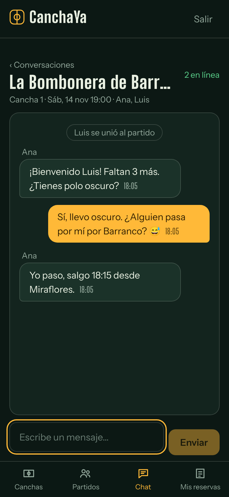

# CanchaYa 

Marketplace de reservas de canchas deportivas con chat y matchmaking en tiempo real.
Proyecto de portafolio con arquitectura **monolito modular + microservicio**.

## ¿Qué problema resuelve?

- **Jugadores:** buscan canchas por zona, deporte y precio, reservan y pagan en línea, y organizan partidos ("faltan 2 para el 7 vs 7").
- **Dueños de locales:** publican canchas, gestionan su agenda y ven sus ingresos.

## Arquitectura



### Monolito (`backend/`)
Módulos: `auth`, `venues` (locales y canchas), `bookings` (disponibilidad, bloqueos temporales, anti doble reserva), `payments` (sandbox), `reviews`, `admin`.

### Microservicio de chat (`chat-service/`)
Chat jugador ↔ dueño por reserva, salas de grupo por partido, tablero de partidos abiertos y presencia en línea.
Consume eventos de RabbitMQ y valida el mismo JWT, sin llamadas síncronas al monolito en el camino crítico.

> Por qué el chat es un servicio aparte: ver [ADR 0001](docs/adr/0001-separar-chat-como-microservicio.md).

### Cómo se conectan: eventos de reservas

Al confirmar el pago de una reserva (o cancelar una ya confirmada), el monolito guarda un evento en una tabla
`outbox_events` **en la misma transacción**; un relevo lo publica en RabbitMQ (`canchaya.events`, claves
`booking.confirmed` / `booking.cancelled`) y el chat abre o cierra la sala de esa reserva. Si RabbitMQ se cae,
los eventos esperan en la tabla y se entregan después; el consumidor es idempotente y los mensajes inválidos van
a una cola de muertos. Detalle en el [ADR 0004](docs/adr/0004-eventos-con-bandeja-de-salida-y-chat-por-reserva.md)
y el contrato en [`docs/contracts/`](docs/contracts/README.md).

#### Chat grupal de cada partido

Al abrir un partido, el chat crea la sala `match:<id>` con el organizador; quien se une entra a ella y quien sale
deja de recibir mensajes al instante. Cancelar el partido o su reserva cierra la sala (el historial se conserva).
Cada evento trae el estado completo y una versión, así que el orden de llegada no importa: ver el
[ADR 0006](docs/adr/0006-chat-grupal-por-partido-con-instantaneas-versionadas.md). Los avisos ("Luis se unió al
partido") son mensajes con `kind: "system"`.

### API del chat (puerto 3002)

REST (con `Authorization: Bearer <JWT>`): `GET /rooms` (mis conversaciones, de reservas y de partidos; cada sala trae `kind`, `memberIds` y `members`) y
`GET /rooms/:id/messages?limit=50&before=<id>` (historial paginado hacia atrás).

Socket.IO (el JWT va en `auth: { token }` al conectar; cada evento admite un `ack`):

| Cliente → servidor | Respuesta |
|---|---|
| `room:join` `roomId` | `{ ok, room, messages (últimos 50), online }` o `{ ok:false, error }` |
| `room:leave` `roomId` | `{ ok }` |
| `message:send` `{ roomId, text }` | `{ ok, message }`; errores: `invalid_message`, `not_joined`, `rate_limited`, `room_closed`, `forbidden` |

Servidor → cliente: `message:new`, `presence:update`, `room:opened`, `room:closed` y `room:left` (te sacaron de una sala de partido porque saliste).

## Stack

| Capa | Tecnología |
|---|---|
| Monolito | NestJS (TypeScript) + PostgreSQL |
| Chat | Node + Socket.IO + MongoDB + Redis |
| Mensajería | RabbitMQ |
| Frontend | Next.js |
| Infra | Docker Compose, GitHub Actions |

## Levantar el proyecto

```bash
cp .env.example .env
docker compose up --build
```

| Servicio | URL |
|---|---|
| Frontend | http://localhost:3000 |
| Monolito (health) | http://localhost:3001/health |
| Chat (health) | http://localhost:3002/health |
| RabbitMQ UI | http://localhost:15672 |
| Swagger (API del monolito) | http://localhost:3001/api |

> **Windows y Docker Desktop:** el reinicio automático (`tsx watch`, `nest start --watch`) no detecta los cambios de
> las carpetas montadas. Tras actualizar el código, ejecuta `docker compose restart backend chat-service` (o
> `docker compose up -d --build <servicio>` si cambiaron dependencias) y comprueba el log: el chat debe decir
> "Consumidor de eventos conectado a RabbitMQ" y `rabbitmqctl list_queues` debe mostrar `chat.bookings` y `chat.matches`.

### Interfaz web (`frontend/`, puerto 3000)

Next.js 14 (App Router) + Tailwind, tema oscuro. Pantallas: inicio, canchas, detalle de cancha con tablero de turnos (1 a 3 horas seguidas), pago, mis reservas (cancelar, buscar jugadores, reseñar), partidos abiertos, registro/ingreso (jugador o dueño), **panel del dueño** (locales, canchas con su horario, activar/desactivar, agenda por día) y **chat en tiempo real** (con el local de cada reserva y con los jugadores de cada partido; se conecta por Socket.IO a `NEXT_PUBLIC_CHAT_URL`).

- Los datos se piden desde el navegador a `NEXT_PUBLIC_API_URL`; la sesión (JWT) se guarda en `localStorage`. Es lo más simple para una demo; en producción convendría una cookie `httpOnly`.
- Pago: por defecto modo demostración con los tokens de la pasarela simulada. Con `NEXT_PUBLIC_PAYMENT_MODE=culqi` y `NEXT_PUBLIC_CULQI_PUBLIC_KEY` se tokeniza la tarjeta con Culqi (ruta aún no probada contra el servicio real).
- Tras cambiar dependencias o archivos de configuración: `docker compose up -d --build frontend`.

### Demo con datos de ejemplo

Con el backend en modo `PAYMENT_PROVIDER=fake`, carga 4 locales, 7 canchas, 5 jugadores, reservas pagadas y 3 partidos abiertos:

```powershell
$env:API_URL="http://localhost:3001"; node scripts/seed-demo.mjs
```

Cuentas (clave `Clave12345`): dueño `dueno@demo.pe`; jugadores `ana@`, `luis@`, `marta@`, `diego@`, `camila@demo.pe`. Si la demo ya existe, el script no hace nada.

| | |
|---|---|
|  |  |
|  |  |
|  |  |

Móvil:  

## API del monolito

El esquema de PostgreSQL lo crean las migraciones de TypeORM al arrancar (nunca `synchronize`).

| Método y ruta | Quién | Qué hace |
|---|---|---|
| `POST /auth/register` | público | Registro como `player` (por defecto) u `owner`. No se puede elegir `admin` |
| `POST /auth/login` | público | Devuelve `accessToken` (JWT) y los datos del usuario |
| `GET /auth/me` | autenticado | Datos del usuario del token |
| `GET /venues` | público | Búsqueda por `zone`, `sport`, `maxPrice`, con paginación (`page`, `limit`) |
| `GET /venues/:id` | público | Detalle de un local con sus canchas activas |
| `GET /venues/mine` | dueño | Mis locales con todas sus canchas |
| `POST /venues` | dueño | Crear local |
| `PATCH /venues/:id`, `DELETE /venues/:id` | dueño del local o admin | Editar o borrar |
| `POST /venues/:id/courts` | dueño del local o admin | Agregar cancha |
| `PATCH /courts/:id`, `DELETE /courts/:id` | dueño del local o admin | Editar (incluido su horario `openHour`/`closeHour`), desactivar o borrar. Una cancha o local con reservas no se borra (409): se desactiva |
| `GET /courts/:id/availability?date=YYYY-MM-DD` | público | Turnos de una hora de esa fecha, con `available` true/false |
| `POST /bookings` | jugador o dueño | Reserva `hours` (1 a 3) desde `startsAt`. Nace `pending` y bloquea el horario 10 min |
| `POST /bookings/:id/pay` | el jugador de la reserva | Cobra con `{ tokenId }` (token de tarjeta `tkn_…`). Si sale bien, la reserva queda `confirmed`. Rechazo → `402`; reserva vencida o ya pagada → `409`; pasarela caída → `503` |
| `POST /bookings/:id/cancel` | jugador, dueño del local o admin | Cancela y, si estaba pagada, devuelve el dinero (`refund`: `none`, `refunded` o `failed`). El jugador solo hasta 2 h antes si ya estaba confirmada |
| `GET /bookings/mine` | jugador o dueño | Mis reservas con su cancha y local |
| `GET /venues/:id/bookings?date=` | dueño del local o admin | Agenda del local (nombre del jugador, sin datos de contacto) |
| `GET /payments/mine` | jugador o dueño | Mis pagos con su reserva |
| `POST /matches` | jugador o dueño | Abre un partido con una reserva confirmada tuya: `{ bookingId, spots (1-20), level?, notes? }` |
| `GET /matches` | público | Partidos abiertos con lugares libres. Filtros: `sport`, `level`, `zone`, `date`, `page`, `limit` |
| `GET /matches/:id` | público | Detalle con lista de jugadores (solo primer nombre) |
| `GET /matches/mine` | jugador o dueño | Los que organizo y a los que me uní (`role`) |
| `POST /matches/:id/join` | jugador o dueño | Ocupa un lugar (`409` si está completo, ya empezó o ya estás dentro) |
| `POST /matches/:id/leave` | jugador o dueño | Libera mi lugar |
| `DELETE /matches/:id` | organizador o admin | Cierra el partido (cancelar la reserva también lo cierra) |
| `POST /payments/:id/retry-refund` | admin | Reintenta una devolución que la pasarela rechazó |
| `POST /payments/webhooks/culqi/:secret` | Culqi | Concilia cobros cuya respuesta se perdió (el secreto va en la URL) |
| `POST /bookings/:id/review` | jugador de la reserva | Reseña (`rating` 1-5, `comment` opcional). Solo reservas confirmadas que ya terminaron, una por reserva |
| `GET /venues/:id/reviews` | público | Reseñas con promedio y total (solo el primer nombre del autor) |
| `DELETE /reviews/:id` | autor o admin | Borra una reseña |

`GET /venues` y `GET /venues/:id` incluyen `rating: { average, count }`.

El JWT lleva `sub` (id del usuario), `email` y `role`, y lo firma el monolito con `JWT_SECRET`. El chat-service valida ese mismo token con el mismo secreto.

### Cómo se evita la doble reserva

No hay "consultar y luego insertar". La tabla `bookings` tiene una restricción de exclusión de PostgreSQL
que impide que dos reservas activas de la misma cancha tengan horarios que se solapen; si dos peticiones
llegan a la vez, la base de datos deja pasar una y la otra recibe un `409`. Los bloqueos de pago que vencen
sin confirmarse liberan el horario solos. Detalle y alternativas descartadas en el
[ADR 0002](docs/adr/0002-evitar-doble-reserva-con-restriccion-de-exclusion.md).

Horarios: los locales operan en hora de Lima (UTC-5); las fechas se guardan en UTC y `startsAt` debe
llevar zona horaria (ej. `2026-11-14T20:00:00-05:00`).

### Pagos

Los pagos pasan por una interfaz (`PaymentProvider`) con dos implementaciones: **Culqi** y una **pasarela
simulada** que se usa si no hay `CULQI_SECRET_KEY` (nunca en producción). Con la simulada, el token decide el
resultado: `tkn_test_ok`, `tkn_test_declined`, `tkn_test_insufficient_funds`, `tkn_test_unavailable` y
`tkn_test_charged_then_unavailable`. Un solo cobro por reserva lo garantiza un índice único parcial de la base
de datos; si la pasarela cobra pero la respuesta se pierde, el webhook lo concilia. Detalle en el
[ADR 0003](docs/adr/0003-pagos-con-pasarela-abstracta-e-idempotencia.md).

Variables: `PAYMENT_PROVIDER` (`culqi`/`fake`), `CULQI_SECRET_KEY`, `CULQI_PUBLIC_KEY`, `CULQI_API_URL`,
`CULQI_WEBHOOK_SECRET`, `PAYMENT_GRACE_SECONDS` (ver `.env.example`).

### Tests y migraciones

```bash
docker compose exec backend npm test                       # unitarios + concurrencia contra PostgreSQL
docker compose exec backend npm run migration:run          # aplicar migraciones a mano
docker compose exec backend npm run migration:generate -- src/database/migrations/NombreCambio
```

Los tests de integración (`*.concurrency.spec.ts`, `*.flow.spec.ts`) corren contra PostgreSQL real: el de
concurrencia dispara decenas de reservas simultáneas por el mismo horario y comprueba que solo una gana; el de
pagos cubre doble clic, rechazos, pasarela caída, webhook y devoluciones; el de reseñas, sus reglas. Cada archivo
crea y borra su propia base `canchaya_test_*` en el mismo servidor, sin tocar tus datos, y se omite si no hay
`DATABASE_URL`. El chat-service tiene sus propios tests (`cd chat-service && npm test`; el de MongoDB se activa
definiendo `MONGO_URL`). La prueba de punta a punta del stack completo es
`docker compose exec chat-service npx tsx scripts/e2e.ts`: registra usuarios, reserva, paga, espera a que el evento
llegue por RabbitMQ, chatea por Socket.IO y cancela.

## Roadmap

- [x] Fase 0: esqueleto del repo e infraestructura
- [x] Fase 1: auth, roles y modelo de datos
- [x] Fase 2: disponibilidad y reservas (tests de concurrencia)
- [x] Fase 3: pagos (Culqi sandbox) y reseñas
- [x] Fase 4: chat en tiempo real y eventos por RabbitMQ
- [x] Fase 5a: matchmaking (partidos abiertos, cupo atómico) — ver [ADR 0005](docs/adr/0005-partidos-abiertos-con-cupo-atomico.md)
- [x] Fase 6a: interfaz web del jugador (buscar, reservar, pagar, partidos abiertos, reseñas)
- [x] Fase 5b: chat grupal por partido — ver [ADR 0006](docs/adr/0006-chat-grupal-por-partido-con-instantaneas-versionadas.md)
- [x] Fase 6b: panel del dueño, chat en la interfaz, datos de demo y capturas
- [ ] Pendiente: demo desplegada (hosting)

## Estructura

```
canchaya/
├── backend/        # Monolito NestJS
├── chat-service/   # Microservicio de chat y matchmaking
├── frontend/       # Next.js
├── docs/adr/       # Decisiones de arquitectura
└── docker-compose.yml
```
