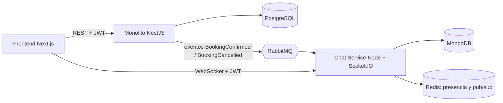

# CanchaYa ⚽

Marketplace de reservas de canchas deportivas con chat y matchmaking en tiempo real.
Proyecto de portafolio con arquitectura **monolito modular + microservicio**.

## ¿Qué problema resuelve?

- **Jugadores:** buscan canchas por zona, deporte y precio, reservan y pagan en línea, y organizan partidos ("faltan 2 para el 7 vs 7").
- **Dueños de locales:** publican canchas, gestionan su agenda y ven sus ingresos.

## Arquitectura



### Monolito (`backend/`)
Módulos: `auth`, `venues` (locales y canchas), `bookings` (disponibilidad, bloqueos temporales, anti doble reserva), `payments` (sandbox), `reviews`, `admin`.

### Microservicio de chat (`chat-service/`)
Chat jugador ↔ dueño por reserva, salas de grupo por partido, tablero de partidos abiertos y presencia en línea.
Consume eventos de RabbitMQ y valida el mismo JWT, sin llamadas síncronas al monolito en el camino crítico.

> Por qué el chat es un servicio aparte: ver [ADR 0001](docs/adr/0001-separar-chat-como-microservicio.md).

## Stack

| Capa | Tecnología |
|---|---|
| Monolito | NestJS (TypeScript) + PostgreSQL |
| Chat | Node + Socket.IO + MongoDB + Redis |
| Mensajería | RabbitMQ |
| Frontend | Next.js |
| Infra | Docker Compose, GitHub Actions |

## Levantar el proyecto

```bash
cp .env.example .env
docker compose up --build
```

| Servicio | URL |
|---|---|
| Frontend | http://localhost:3000 |
| Monolito (health) | http://localhost:3001/health |
| Chat (health) | http://localhost:3002/health |
| RabbitMQ UI | http://localhost:15672 |
| Swagger (API del monolito) | http://localhost:3001/api |

## API del monolito

El esquema de PostgreSQL lo crean las migraciones de TypeORM al arrancar (nunca `synchronize`).

| Método y ruta | Quién | Qué hace |
|---|---|---|
| `POST /auth/register` | público | Registro como `player` (por defecto) u `owner`. No se puede elegir `admin` |
| `POST /auth/login` | público | Devuelve `accessToken` (JWT) y los datos del usuario |
| `GET /auth/me` | autenticado | Datos del usuario del token |
| `GET /venues` | público | Búsqueda por `zone`, `sport`, `maxPrice`, con paginación (`page`, `limit`) |
| `GET /venues/:id` | público | Detalle de un local con sus canchas activas |
| `GET /venues/mine` | dueño | Mis locales con todas sus canchas |
| `POST /venues` | dueño | Crear local |
| `PATCH /venues/:id`, `DELETE /venues/:id` | dueño del local o admin | Editar o borrar |
| `POST /venues/:id/courts` | dueño del local o admin | Agregar cancha |
| `PATCH /courts/:id`, `DELETE /courts/:id` | dueño del local o admin | Editar, desactivar o borrar |

El JWT lleva `sub` (id del usuario), `email` y `role`, y lo firma el monolito con `JWT_SECRET`. El chat-service valida ese mismo token con el mismo secreto.

### Tests y migraciones

```bash
docker compose exec backend npm test                       # tests unitarios
docker compose exec backend npm run migration:run          # aplicar migraciones a mano
docker compose exec backend npm run migration:generate -- src/database/migrations/NombreCambio
```

## Roadmap

- [x] Fase 0: esqueleto del repo e infraestructura
- [x] Fase 1: auth, roles y modelo de datos
- [ ] Fase 2: catálogo y reservas (tests de concurrencia)
- [ ] Fase 3: pagos (sandbox) y reseñas
- [ ] Fase 4: chat en tiempo real y eventos por RabbitMQ
- [ ] Fase 5: matchmaking (partidos abiertos)
- [ ] Fase 6: pulido, demo desplegada y capturas

## Estructura

```
canchaya/
├── backend/        # Monolito NestJS
├── chat-service/   # Microservicio de chat y matchmaking
├── frontend/       # Next.js
├── docs/adr/       # Decisiones de arquitectura
└── docker-compose.yml
```
